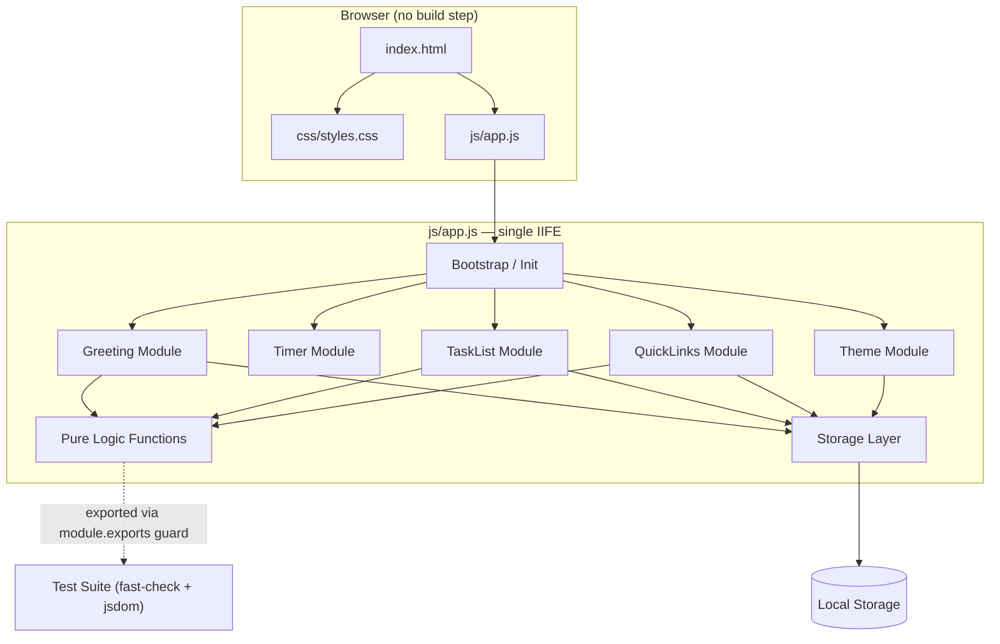
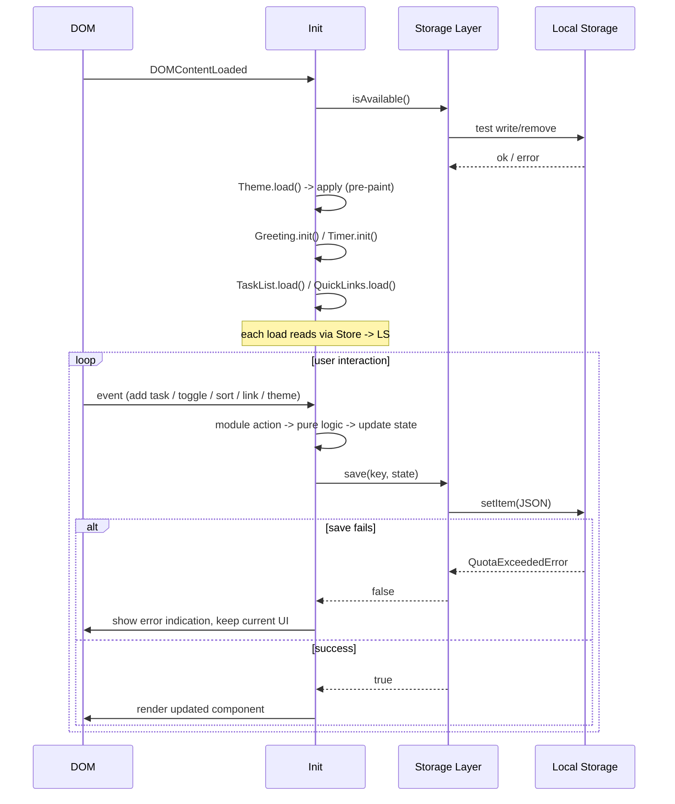

# Design Document

## Overview

The To-do List Life Dashboard is a client-side single-page web application that acts as a personal productivity start page. It renders four primary components on one page: a personalized Greeting with a live clock, a 25-minute Focus Timer, a color-coded To-Do List with full CRUD operations and color sorting, and a set of user-managed Quick Links to favorite websites. A light/dark theme toggle applies across the whole dashboard.

The application is built with plain HTML for structure, a single CSS file for styling (including theming via CSS custom properties), and a single vanilla JavaScript file for all behavior. No external frameworks, libraries, or build tools are used at runtime. All persistent state — user name, tasks, quick links, and theme — is stored in the browser's Local Storage API. The app runs as a standalone page opened directly from the filesystem and is compatible with Chrome, Firefox, Edge, and Safari.

The design's central principle is a clean separation between **pure, testable logic** and **DOM-dependent rendering**. Greeting calculation, input validation, color sorting, and serialization are implemented as standalone pure functions so they can be verified with property-based tests, while the UI layer (DOM creation, event wiring, rendering) is verified with example-based and integration tests.

## Architecture

### High-Level Architecture

The application follows a lightweight component-oriented architecture contained within a single JavaScript file. The file is wrapped in an IIFE to avoid polluting the global scope and is internally organized into logical modules: a Storage layer, four feature components (Greeting, Timer, TaskList, QuickLinks), a Theme manager, and a bootstrap initializer. Pure logic functions live at the top of the IIFE, isolated from DOM code, and are exported to Node via a CommonJS guard so the same source file feeds both the browser app and the test suite.



### File Structure

The dashboard is served as a flat set of static files with no bundler, server, or package manager required at runtime:

```
/
├── index.html          # Page structure and component containers
├── css/
│   └── styles.css      # Single stylesheet: layout, components, light/dark themes
├── js/
│   └── app.js          # Single script: all behavior (IIFE + exported pure logic)
└── README.md
```

This satisfies Requirement 9: exactly one CSS file in `css/`, exactly one JS file in `js/`, HTML for structure, CSS for styling, vanilla JS for behavior, no frameworks/libraries, no backend server, and all data client-side via Local Storage.

### Design Decisions and Rationale

| Decision | Choice | Rationale |
|----------|--------|-----------|
| Code organization | Single IIFE with internal logical modules | Honors the one-JS-file constraint while keeping concerns separated and the global scope clean. |
| Logic/render split | Pure functions isolated from DOM code | Enables property-based testing of business logic without a DOM; the same file exports logic for tests. |
| Test export | `if (typeof module !== 'undefined') module.exports = {...}` guard | One source file serves both the browser (IIFE + DOM init) and Node tests (pure-logic exports), with no duplicate code. |
| Theming | CSS custom properties driven by `data-theme` on `<html>` | Switching one attribute restyles the entire page instantly (Requirement 6.3) and is supported in all target browsers. |
| Persistence | Local Storage with feature detection + try/catch | Safari private mode reports availability but throws `QuotaExceededError` (or silently fails with zero quota) on writes; detection plus guarded writes give graceful degradation (Requirements 4.5, 6.9). |
| External links | `target="_blank" rel="noopener noreferrer"` | Opens links in a new tab (Requirement 5.2) while preventing opener-window hijacking and leaking the referrer ([MDN](https://developer.mozilla.org/en-US/docs/Web/HTML/Reference/Attributes/rel/noopener)). |
| IDs | Generated with `crypto.randomUUID()` where available, else `Date.now()+random` fallback | Stable unique keys for tasks/links across re-render; the fallback keeps compatibility with older Safari. |
| Test-only tooling | Vitest + fast-check + jsdom as devDependencies | The no-framework/no-library constraint (Requirement 9.3) applies to the runtime app, not to the test harness; these tools never ship to the browser. |

### Research and Key Findings

- **Local Storage reliability.** `localStorage` is synchronous and supported in all target browsers, but Safari private mode makes it appear available while throwing `QuotaExceededError` on write (older versions) or silently accepting writes that return `null` on read (zero quota). The Storage layer therefore performs a real test write/remove in a try/catch to detect availability, and wraps every write in try/catch so a failed save never crashes the app — it surfaces an error indication and keeps the current in-memory state (Requirements 4.5, 6.9). Sources: [MDN Web Storage API](https://developer.mozilla.org/en-US/docs/Web/API/Web_Storage_API), [TrackJS](https://trackjs.com/javascript-errors/failed-to-execute-setitem-on-storage/).
- **`target="_blank"` security.** Modern browsers auto-apply `rel="noopener"` to `target="_blank"` anchors, but explicitly setting `rel="noopener noreferrer"` is still recommended for legacy-browser compatibility and to suppress the `Referer` header for privacy. Quick Link buttons use this attribute pair (Requirement 5.2). Sources: [MDN rel=noopener](https://developer.mozilla.org/en-US/docs/Web/HTML/Reference/Attributes/rel/noopener), [Chrome DevTools](https://developer.chrome.com/docs/lighthouse/best-practices/external-anchors-use-rel-noopener/).
- **CSS custom properties.** All four target browsers support CSS custom properties and the `data-*` attribute selector, so theming via a `data-theme` attribute on the root element is safe and avoids JS-driven style recalculation per element.

## Components and Interfaces

Each module exposes a small set of functions. Functions marked **(pure)** contain no DOM or Local Storage access and are the targets of property-based tests. TypeScript-style signatures are used for documentation only; the implementation is plain JavaScript.

### Storage Layer

Wraps Local Storage with JSON serialization, availability detection, and graceful error handling. Every other module reads and writes through this layer.

```typescript
namespace Storage {
  isAvailable(): boolean;                 // (memoized) real test write/remove
  load<T>(key: string, fallback: T): T;    // JSON.parse, returns fallback on miss/parse error
  save(key: string, value: unknown): boolean; // JSON.stringify, try/catch, returns success
  remove(key: string): void;
}
```

Storage keys (all namespaced under `tld.`):

| Key | Stored Type | Read By | Written By |
|-----|-------------|---------|------------|
| `tld.user.name` | `string` | Greeting | Greeting |
| `tld.tasks` | `Task[]` (JSON) | TaskList | TaskList |
| `tld.quickLinks` | `QuickLink[]` (JSON) | QuickLinks | QuickLinks |
| `tld.theme` | `"light" \| "dark"` | Theme | Theme |

### Greeting Module

Renders a time-of-day greeting, live 12-hour clock, full date, and an editable user name.

```typescript
// (pure) hour 0-23 -> greeting string
getGreeting(hour: number): "Good morning" | "Good afternoon" | "Good evening";
// (pure) Date -> "h:mm AM/PM"
formatTime(date: Date): string;
// (pure) Date -> "Weekday, Month Day"
formatDate(date: Date): string;
// (pure) name -> valid saveable? (non-empty after trim, length <= 50)
isValidUserName(name: string): boolean;

namespace Greeting {
  init(root: HTMLElement): void;   // cache nodes, start 1s clock interval, wire name edit
  render(): void;                 // update time, date, greeting, name display
  setName(name: string): void;    // validate, persist, re-render
}
```

### Timer Module

A 25-minute countdown state machine with start/stop/reset.

```typescript
const TIMER_DURATION_SECONDS = 1500; // 25 * 60

// (pure) seconds 0-1500 -> "MM:SS"
formatTimer(seconds: number): string;
// (pure) next timer state after one tick (clamped at 0)
tickTimer(state: TimerState): TimerState;
// (pure) next state after reset (always 1500, stopped)
resetTimer(state: TimerState): TimerState;

namespace Timer {
  init(root: HTMLElement): void;
  start(): void;   // begin/continue countdown via setInterval
  stop(): void;    // clear interval, keep remaining
  reset(): void;   // clear interval, remaining = 1500
  render(): void;  // update MM:SS display + completion indicator
}
```

### TaskList Module

Manages tasks with add/edit/toggle-done/delete/sort and Local Storage persistence.

```typescript
// (pure) text -> valid? (1 <= trimmed length <= 200)
validateTaskText(text: string): boolean;
// (pure) color -> one of red|yellow|green
isValidColor(color: string): boolean;
// (pure) tasks -> new array sorted red, yellow, green (stable within color)
sortTasks(tasks: Task[]): Task[];

namespace TaskList {
  init(root: HTMLElement): void;
  add(text: string, color: TaskColor): void;       // validate, append, render, persist
  edit(id: string, text: string, color: TaskColor): void;
  toggleDone(id: string): void;
  remove(id: string): void;
  sort(): void;                                     // apply sortTasks to state, render, persist
  render(): void;
  load(): void;                                     // read Storage, validate, set state, render
  persist(): boolean;                               // save state, surface error on failure
}
```

### QuickLinks Module

Manages link buttons with add/remove and Local Storage persistence; clicks open the URL in a new tab.

```typescript
// (pure) label+url -> { valid, error? }
validateQuickLink(label: string, url: string): { valid: boolean; error?: string };

namespace QuickLinks {
  init(root: HTMLElement): void;
  add(label: string, url: string): void;           // validate, append, render, persist
  remove(id: string): void;
  render(): void;
  load(): void;
  persist(): boolean;
}
```

### Theme Module

Applies and persists the light/dark theme.

```typescript
// (pure) theme -> "light"|"dark"
isValidTheme(theme: string): boolean;
const DEFAULT_THEME: "light" = "light";

namespace Theme {
  init(root: HTMLElement): void;     // cache toggle button, load, apply
  apply(theme: Theme): void;         // set <html data-theme>, update toggle UI
  toggle(): void;                    // light<->dark, apply, persist
  load(): void;                      // read Storage or default to light
  persist(theme: Theme): void;       // save (no-op if Storage unavailable)
}
```

### Bootstrap / Init

Runs once on `DOMContentLoaded` (guarded by `typeof document !== 'undefined'`):

1. Detect Storage availability.
2. Initialize Theme (apply before paint to avoid a flash of the wrong theme).
3. Initialize Greeting, Timer, TaskList, QuickLinks (each loads its own persisted state).
4. Wire global event listeners (theme toggle, name edit, timer controls, task form, link form).

### Component Interaction



## Data Models

TypeScript-style interfaces are used for documentation only; the runtime uses plain JavaScript objects serialized to JSON in Local Storage.

### Task

```typescript
interface Task {
  id: string;                // stable unique identifier
  text: string;               // 1-200 characters (trimmed before validation)
  color: "red" | "yellow" | "green";  // exactly one priority color
  done: boolean;              // completion status
}
```

### QuickLink

```typescript
interface QuickLink {
  id: string;                // stable unique identifier
  label: string;              // non-empty display label
  url: string;                // must start with "http://" or "https://"
}
```

### Theme

```typescript
type Theme = "light" | "dark";
```

### UserName

```typescript
type UserName = string;  // trimmed; valid to save when non-empty and length <= 50
```

### Timer State (in-memory only, not persisted)

```typescript
interface TimerState {
  remainingSeconds: number;  // 0 .. 1500
  isRunning: boolean;
  intervalId: number | null; // setInterval handle (not serialized)
}
```

The Timer is intentionally **not** persisted: the requirements define it as a session-scoped 25-minute focus tool with start/stop/reset, with no cross-session continuation requirement. On load it always initializes to 25:00 stopped.

### Local Storage Schema

| Key | JSON Shape | Notes |
|-----|------------|-------|
| `tld.user.name` | `string` | Stored as a raw JSON string (e.g. `"Taqiyya"`). Absent ⇒ no name shown. |
| `tld.tasks` | `Task[]` | Ordered array; order is the display order. |
| `tld.quickLinks` | `QuickLink[]` | Ordered array. |
| `tld.theme` | `"light"\|""dark"` | Absent ⇒ defaults to `"light"`. |


## Correctness Properties

*A property is a characteristic or behavior that should hold true across all valid executions of a system — essentially, a formal statement about what the system should do. Properties serve as the bridge between human-readable specifications and machine-verifiable correctness guarantees.*

The dashboard's pure logic layer (greeting calculation, input validation, color sorting, timer state transitions, and JSON serialization round-trips) is suitable for property-based testing because these are pure functions with large input spaces and universal invariants. DOM rendering, browser compatibility, and performance are verified with example-based, integration, and smoke tests instead (see Testing Strategy).

### Property 1: Greeting partitions the day correctly

*For any* integer hour in 0..23, `getGreeting(hour)` SHALL return exactly one of "Good morning", "Good afternoon", or "Good evening", matching the requirement ranges: hours 5..11 → morning, 12..16 → afternoon, and 0..4 or 17..23 → evening.

**Validates: Requirements 1.4, 1.5, 1.6**

### Property 2: 12-hour time format

*For any* `Date`, `formatTime(date)` SHALL return a string matching the 12-hour pattern `h:mm AM` or `h:mm PM` with an hour value in 1..12.

**Validates: Requirements 1.2**

### Property 3: Full date format

*For any* `Date`, `formatDate(date)` SHALL return a string containing the full weekday name, the full month name, and the day-of-month number.

**Validates: Requirements 1.3**

### Property 4: User name validation boundary

*For any* string, `isValidUserName(name)` SHALL return true if and only if the trimmed string is non-empty and its length is less than or equal to 50.

**Validates: Requirements 1.1, 1.10**

### Property 5: User name persistence round-trip

*For any* valid user name, saving the name to Local Storage and then loading it back SHALL return the identical name.

**Validates: Requirements 1.7, 1.8**

### Property 6: Timer fresh and reset state

*For any* timer state, a freshly initialized timer and `resetTimer(state)` SHALL both yield `{ remainingSeconds: 1500, isRunning: false }`.

**Validates: Requirements 2.1, 2.4**

### Property 7: Timer stop preserves remaining time

*For any* running timer state, applying stop SHALL set `isRunning` to false while leaving `remainingSeconds` unchanged.

**Validates: Requirements 2.3**

### Property 8: Timer tick decrements and floors at zero

*For any* running timer state with `remainingSeconds > 0`, `tickTimer(state)` SHALL reduce `remainingSeconds` by exactly 1; and for `remainingSeconds == 0`, `tickTimer` SHALL leave it at 0 and set `isRunning` to false (the timer never goes negative).

**Validates: Requirements 2.2, 2.5**

### Property 9: Timer display format

*For any* integer `remainingSeconds` in 0..1500, `formatTimer(remainingSeconds)` SHALL return a string matching `MM:SS` with two-digit minutes and two-digit seconds.

**Validates: Requirements 2.6**

### Property 10: Task text validation boundary

*For any* string, `validateTaskText(text)` SHALL return true if and only if the trimmed length is between 1 and 200 inclusive.

**Validates: Requirements 3.1, 3.2, 3.6**

### Property 11: Task color invariant

*For any* task, its `color` SHALL be exactly one of `"red"`, `"yellow"`, or `"green"`; equivalently, `isValidColor(color)` is true only for those three values, and every task created or loaded satisfies it.

**Validates: Requirements 3.7**

### Property 12: Task add/remove count invariant

*For any* task list and any valid new task, adding the task SHALL increase the list length by 1 and the task SHALL be present in the list; removing an existing task by id SHALL decrease the length by 1 and that id SHALL be absent from the list.

**Validates: Requirements 3.1, 3.4**

### Property 13: Task mutation preserves identity

*For any* task, editing with a valid text and color SHALL update only `text` and `color` while preserving `id`, `done`, list count, and list position; toggling done SHALL flip only `done` while preserving `id`, `text`, `color`, list count, and list position.

**Validates: Requirements 3.2, 3.3**

### Property 14: Task sort ordering, count, and idempotence

*For any* task list, `sortTasks(tasks)` SHALL produce a list where every red task precedes every yellow task and every yellow task precedes every green task, the result length SHALL equal the input length, and `sortTasks(sortTasks(tasks))` SHALL equal `sortTasks(tasks)` (idempotence).

**Validates: Requirements 3.5**

### Property 15: Task list persistence round-trip

*For any* valid task list, serializing the list to Local Storage and then deserializing it SHALL yield an equivalent list with the same count, the same order, and for each task the same `text`, `color`, and `done`.

**Validates: Requirements 4.1, 4.2, 4.4**

### Property 16: Quick link validation

*For any* label and url, `validateQuickLink(label, url)` SHALL be invalid if and only if the label is empty, or the url is empty, or the url does not begin with `http://` or `https://`.

**Validates: Requirements 5.4**

### Property 17: Quick link add/remove count invariant

*For any* quick link set and any valid new link, adding the link SHALL increase the set length by 1 and the link SHALL be present; removing an existing link by id SHALL decrease the length by 1 and that id SHALL be absent.

**Validates: Requirements 5.1, 5.3**

### Property 18: Quick link set persistence round-trip

*For any* valid quick link set, serializing the set to Local Storage and then deserializing it SHALL yield an equivalent set with the same count, the same order, and for each link the same `label` and `url`.

**Validates: Requirements 5.5, 5.6, 5.7**

### Property 19: Theme toggle flips mode

*For any* theme, `toggle` SHALL yield the opposite theme: `"light"` becomes `"dark"` and `"dark"` becomes `"light"`.

**Validates: Requirements 6.3**

### Property 20: Theme persistence round-trip

*For any* theme, saving the theme to Local Storage and then loading it back SHALL return the identical theme.

**Validates: Requirements 6.4, 6.5**

## Error Handling

The design treats failures as recoverable: the UI stays usable and informative whenever storage or input is invalid. Errors never crash the app.

### Local Storage Errors

| Scenario | Behavior | Validates |
|----------|----------|-----------|
| Local Storage unavailable (e.g. Safari private mode) | `Storage.isAvailable()` returns false (memoized via a real test write/remove). All modules run in-memory for the session; no persistence is attempted. | 6.9 |
| Write quota exceeded / write throws | `Storage.save` catches the exception, returns `false`, and leaves in-memory state intact. The calling module shows an inline error indication and keeps the current display. | 4.5 |
| Stored value missing | `Storage.load` returns the provided fallback (empty array, empty string, or default theme). | 4.3, 5.8, 6.6 |
| Stored value unparseable as JSON or wrong shape | `Storage.load` catches the parse error and returns the fallback (e.g. empty task list), so the component renders its empty state rather than crashing. | 4.6 |

Each persistence-aware module surfaces storage failures through a small inline status element (an `aria-live` region) so users are informed without modal interruption. When a save fails, the in-memory list/links/theme remain on screen and editable, so no work is lost in the session.

### Input Validation Errors

| Component | Invalid Input | Behavior | Validates |
|-----------|---------------|----------|-----------|
| Greeting | Empty user name on submit | Name is not saved; current (or absent) name remains; no error text (silent no-op per requirement). | 1.10 |
| TaskList | Empty or >200-char text on add/edit | Submission rejected; no task added/changed; inline error indication "Task text must be between 1 and 200 characters". | 3.6 |
| QuickLinks | Empty label, empty URL, or non-http(s) URL | Submission rejected; no button added; inline error message indicating the invalid input. | 5.4 |

### Timer Edge Cases

- **Reaching zero:** the countdown stops (interval cleared, `isRunning=false`), remaining stays at 0, and a visible completion indicator is shown; it never displays negative time. (2.5)
- **Start while running:** idempotent — re-pressing start does not create a second interval (guard against duplicate `setInterval` handles).
- **Stop when not running:** no-op, remaining preserved.
- **Reset from any state:** clears any active interval and returns to 25:00 stopped.

### Error-Indication Principles

- All error/status messages use plain text in an `aria-live="polite"` region for accessibility.
- Errors are non-blocking (inline, not modal) and disappear once the next valid action succeeds.
- No error path mutates persisted data; failed writes leave Local Storage and in-memory state consistent with the last successful state.

## Testing Strategy

### Why Property-Based Testing Applies

The dashboard contains a substantial pure-logic layer — greeting calculation, input validation (name, task text, quick-link URL), color sorting, timer state transitions, and JSON serialization round-trips. These are pure functions with large input spaces and universal invariants, which is exactly where property-based testing excels. DOM rendering, browser compatibility, and performance are verified with example-based, integration, and smoke tests instead.

### Test Tooling (test-only; not shipped to the browser)

The no-framework/no-library constraint (Requirement 9.3) applies to the runtime app, not the test harness. A minimal `package.json` (devDependencies only) provides:

- **fast-check** — property-based testing generator and runner for the pure-logic properties.
- **Vitest** — test runner with a `jsdom` environment for DOM/rendering tests.
- **jsdom** — in-browser-like DOM and `localStorage` for unit and integration tests.

No runtime dependencies are introduced; these tools never execute in the dashboard itself.

### How app.js is tested from one file

The single `js/app.js` is structured so pure functions are isolated at the top of the IIFE and exported via a CommonJS guard at the bottom:

```javascript
(function () {
  // --- pure logic (no DOM, no Local Storage) ---
  function getGreeting(hour) { /* ... */ }
  function validateTaskText(text) { /* ... */ }
  function sortTasks(tasks) { /* ... */ }
  function tickTimer(state) { /* ... */ }
  // ... other pure functions

  // --- DOM-dependent code, guarded ---
  if (typeof document !== 'undefined') {
    document.addEventListener('DOMContentLoaded', init);
  }

  // --- exports for Node tests ---
  if (typeof module !== 'undefined' && module.exports) {
    module.exports = {
      getGreeting, validateTaskText, sortTasks, tickTimer,
      /* ...all pure functions + serialize/deserialize helpers */
    };
  }
})();
```

This keeps one source of truth: the browser runs the IIFE + DOM init, while Node tests `require('./js/app.js')` and exercise the exported pure functions. Serialization round-trip tests use exported `serialize`/`deserialize` (or `Storage.save`/`load` backed by a jsdom `localStorage` mock).

### Dual Testing Approach

**Property tests (fast-check):** one test per Correctness Property above, minimum 100 iterations each. Each test is tagged with a comment referencing its design property.

```javascript
// Feature: todo-list-life-dashboard, Property 1: Greeting partitions the day correctly
import fc from 'fast-check';
const { getGreeting } = require('../js/app.js');

test('Property 1: getGreeting partitions all 24 hours', () => {
  fc.assert(fc.property(fc.integer({ min: 0, max: 23 }), (hour) => {
    const g = getGreeting(hour);
    if (hour >= 5 && hour <= 11) return g === 'Good morning';
    if (hour >= 12 && hour <= 16) return g === 'Good afternoon';
    return g === 'Good evening';
  }));
});
```

Tag format: `Feature: todo-list-life-dashboard, Property {number}: {property_text}`. Each correctness property maps to exactly one property-based test.

**Unit tests (example-based):** cover specific examples, edge cases, and DOM rendering in jsdom. Focused, not exhaustive, since property tests cover broad input ranges:
- Empty/whitespace-only and 201-char task text rejection (Property 10 edge cases).
- Loading with no stored tasks/links/theme yields the empty/default state (Requirements 4.3, 5.8, 6.6).
- Corrupt Local Storage data yields the empty state (Requirement 4.6).
- A failed save shows an error indication and keeps current state (Requirement 4.5).
- Done task renders the completion CSS class/indicator (Requirement 3.3).
- A quick link button renders as an anchor with `target="_blank" rel="noopener noreferrer"` and the correct `href` (Requirement 5.2).
- Theme apply sets `data-theme` on the root element (Requirements 6.1, 6.2); default-to-light when none saved (Requirement 6.6); apply works when Storage unavailable (Requirement 6.9).
- Heading font-size > body font-size and controls have a visible boundary (Requirement 6.7).

**Integration tests:** verify Local Storage wiring end-to-end in jsdom:
- Each mutation (add/edit/toggle/delete/sort for tasks; add/remove for links; toggle for theme; update name) triggers a persist and the value round-trips through the real jsdom `localStorage`.
- The clock interval fires and updates the time display (Requirement 1.2 integration half).
- Render of all four components on init (Requirement 7.1 smoke).

**Smoke/static checks:** one-time structural and compatibility assertions:
- `index.html` references exactly one `css/*.css` and one `js/*.js` (Requirements 9.1, 9.2).
- No external CDN scripts/stylesheets and no runtime npm dependencies (Requirement 9.3).
- No `fetch`/`XMLHttpRequest`/`WebSocket` usage in `app.js` (Requirement 9.4).
- The app initializes under a file://-equivalent jsdom setup (Requirement 7.2).

**Manual / cross-browser:** rendering and interaction verified by hand in Chrome, Firefox, Edge, and Safari, and against the performance budgets (Requirements 7.1, 7.3, 8.1, 8.2, 8.3) since these are not suitable for property-based or pure unit testing.

### Coverage Summary

| Requirement | Primary Verification |
|-------------|----------------------|
| 1 Greeting | Properties 1-5 + unit/integration for clock interval & display |
| 2 Timer | Properties 6-9 + unit for zero indication |
| 3 To-Do List | Properties 10-14 + unit for done indicator |
| 4 Task Persistence | Property 15 + unit for empty/corrupt/failed-save edge cases |
| 5 Quick Links | Properties 16-18 + unit/integration for new-tab anchor |
| 6 Theme | Properties 19-20 + unit for apply/default/unavailable |
| 7 Browser Compat | Smoke + manual cross-browser |
| 8 Performance | Integration timing + manual |
| 9 File Structure | Smoke/static checks |
